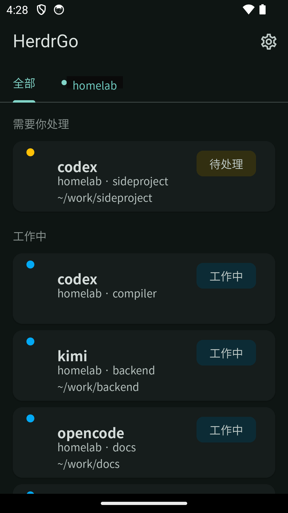
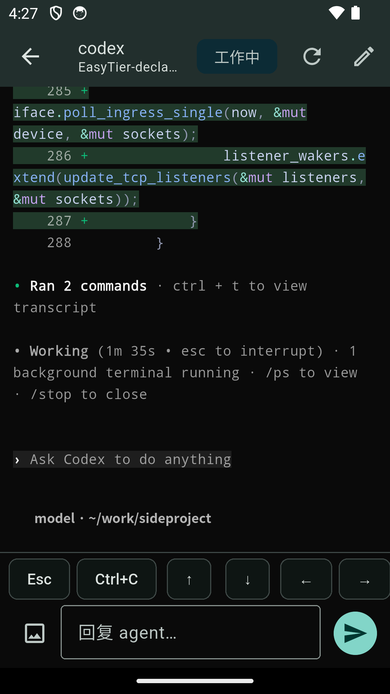
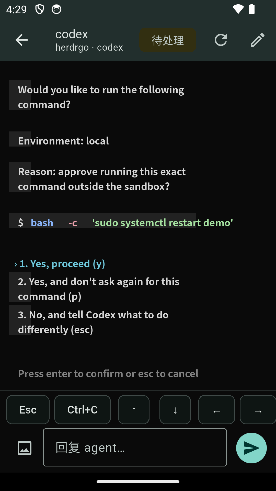

<div align="center">

# HerdrGo

**Your whole herd of coding agents, in your pocket.**

A native mobile client for [herdr](https://herdr.dev) agents

`Flutter` · `Android` · `Rust bridge` · `EasyTier P2P`

**[中文文档 → README_CN.md](README_CN.md)**

</div>

---

Running several coding agents (codex, kimi, claude, …) on your dev box is great
until you step away — then any of them can stall on an approval prompt with
nobody to click it. HerdrGo lets you watch the whole herd from your phone:
see at a glance who's working and who's blocked waiting on you, then tap in to
reply, send keys, or approve — from anywhere.

Pairing is a single QR scan. The bridge runs on your host, prints a QR code on
startup, and the app connects over an EasyTier virtual network — no TUN, no
root, no VPN permission. The network secret is generated and persisted
automatically, so it works out of the box with zero arguments.

## Screenshots

<p>
  
  &nbsp;
  
  &nbsp;
  
</p>

*Left: the dashboard pins agents that need you ("需要你处理" = needs your input)
above the working ones. Middle: the agent conversation is a terminal mirror with
ANSI colors, plus a key bar for Esc / Ctrl+C / arrows / send. Right: a
Claude-style approval menu recognized as native buttons — one tap to approve.*

## Features

- **Dashboard triage** — blocked agents float to the top ("needs you"), working
  next, the rest sink; pull-to-refresh, offline/read-only banners, multi-session
  switching.
- **Agent conversation** — ANSI-colored terminal mirror with auto-follow, a reply
  box, and a special key bar (Esc / Ctrl+C / arrows / Tab / Shift+Tab / Enter).
- **Native dialog buttons** — Claude-style single-select approval/prompt menus
  (prompt-select) become native buttons, guarded by a fresh-read → re-recognize →
  structural-equality → expectedPrompt-binding chain before any key is sent.
- **History** — paged full conversation read from the agent's own session log
  (beyond the terminal scrollback).
- **Agent creation** — start a supported Herdr agent from the phone in an
  existing or new workspace, with an optional initial task (Herdr 0.8.2+).
- **Images** — pick from the gallery, upload to the host, and the returned path
  is auto-filled into the reply box.
- **Notifications** — WorkManager background polling (≥15 min) with local
  notifications for newly-blocked agents, tapping straight into the agent;
  silenced while the app is in the foreground.

## How it works

```
┌─────────────┐    scan QR code     ┌──────────────────────────────┐
│  HerdrGo    │ ◄───────────────── │  herdrgo-bridge (host)       │
│  app (phone)│                     │  · talks to the herdr socket  │
└──────┬──────┘                     │  · exposes a REST API         │
       │ EasyTier virtual network   │  · embedded EasyTier (no TUN) │
       │ (P2P, encrypted; the relay └──────────────┬───────────────┘
       │  can't read it)                           │
       └───────────────────────────────────────────┘
                 virtual TCP over the data plane
```

The app never talks to the herdr socket directly; every read/write goes through
the bridge. The bridge embeds EasyTier to expose its REST API on a virtual TCP
data plane, and the app embeds EasyTier too to forward a local port into the
virtual network — all in userspace, no TUN or root. The network secret is the
only credential: keep the QR code private.

## Build

The toolchain is pinned in `.toolchain/` (Flutter 3.47.0 + Android SDK 36;
NDK 26 is symlinked from `/opt/android-sdk`):

```bash
source .toolchain/env.sh
cd app
flutter pub get
flutter test                 # unit tests (incl. pane-fixture golden tests)
flutter build apk --release  # output: app/build/app/outputs/flutter-apk/app-release.apk
```

For a debug build, `adb install` the `app-debug.apk` onto an emulator/phone.

### EasyTier JNI sync

The app embeds EasyTier (no TUN; it reaches the bridge inside the virtual
network via a 127.0.0.1 port forward driven by EasyTier's own management RPC
`PatchConfig` port-forward patches). The native artifacts
(`libeasytier_android_jni.so` + Kotlin bindings) are built from the EasyTier
repo and copied into `app/android/app/src/main/` (jniLibs and
`kotlin/com/easytier/jni/`) by `app/tool/sync_easytier.sh`:

```bash
app/tool/sync_easytier.sh   # idempotent; EASYTIER_REPO overrides the repo path
```

`EasyTierManager.kt`/`EasyTierVpnService.t.kt` depend on VpnService and moshi
and are not synced. The Dart wrapper lives in `app/lib/api/easytier_channel.dart`.

On iOS, `app/tool/build_ios_easytier.sh` (run on macOS) builds the thin
`easytier-ios` C ABI static library from the same EasyTier repo branch and
copies it into `app/ios/Frameworks/`.

## Deploy the bridge

The bridge runs on the herdr host:

```bash
cd bridge
cargo build --release
# output: bridge/target/release/herdrgo-bridge
```

A systemd unit is available under `bridge/systemd/`. The bridge **enters
EasyTier mode with zero configuration by default**: it generates and persists a
network secret, joins via the default relay `txt://herdrgo.et-link.cc`, and
serves the REST API over the data-plane virtual TCP — listening on no OS port,
needing no TUN/root. It prints the pairing QR code on startup; scan it from the
app to connect (the app likewise uses embedded EasyTier + a local port forward,
no VpnService). The only common options are `--secret` / `--server` / `--port`
(`--help`); advanced options are under `--help-advance`. The secret is the
network credential — treat it like a key, show it only in the host terminal,
never leak it. See `bridge/README.md`.

For plain HTTP direct mode (local / reverse-proxy debugging), disable EasyTier
explicitly with `herdrgo-bridge --secret ""`; it then listens on
`--host`/`--http-port` (default `127.0.0.1:8787`), and you can enable a device
gate with `HERDRGO_BRIDGE_DEVICE_HEADER` (+`HERDRGO_BRIDGE_DEVICE_ALLOWLIST`) —
on first launch the app asks for the bridge address and the matching header
(otherwise it stays read-only).

## Known limitations

- Background blocked notifications only watch the primary session; agents in
  non-primary sessions going blocked do not notify.
- Only single-select dialogs (prompt-select) are recognized as buttons;
  wizard/multi-select/menu fall back to the raw mirror + key bar (not ported in
  v1).
- Sending text from the reply box while a dialog is on screen asks for
  confirmation first (blindly sending Enter could approve the highlighted
  option); free-text items can still be answered after confirming.
- Background polling has a 15-minute minimum (Android WorkManager floor), so
  notifications may be delayed.

## Test fixtures

`app/test/fixtures/panes/*.txt` are vendored real pane captures (byte-faithful,
CRLF included; `.gitattributes` disables text normalization) with no runtime
dependency on external repos; the prompt-select golden tests are based on them.
